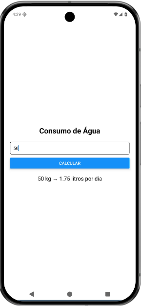
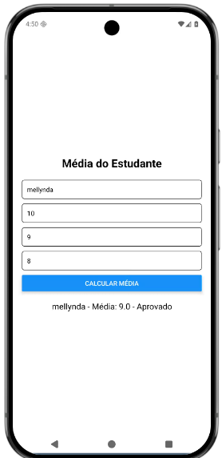
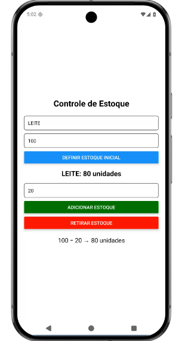
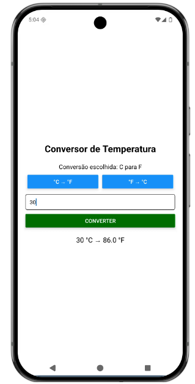
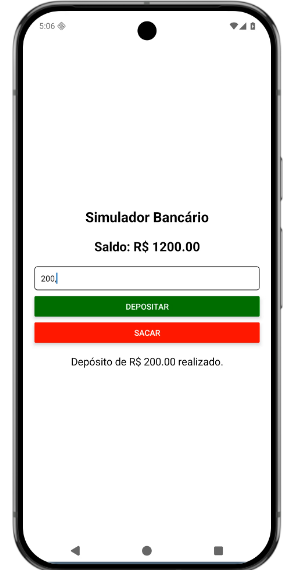
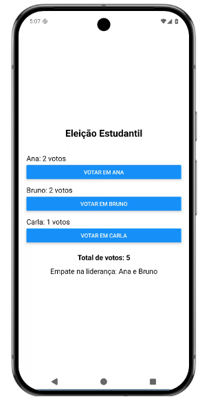
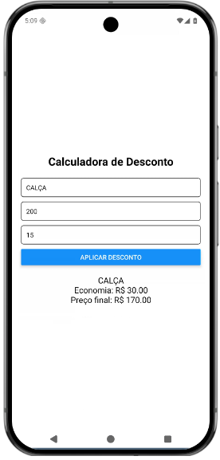
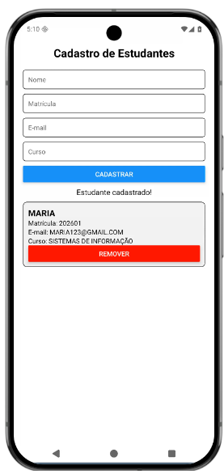
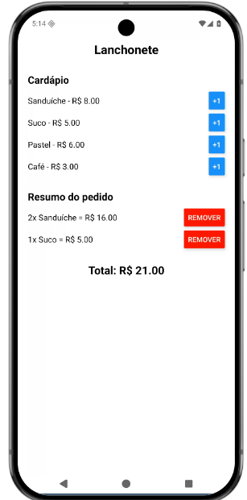

# Lista de Exercício 01 – React Native

Disciplina de Desenvolvimento para Dispositivos Móveis – UFRA

Cada pasta é um projeto Expo independente:

| Questão | Pasta | App |
|---|---|---|
| 01 | `questao01-hidratacao` | Consumo diário de água (35 mL/kg) |
| 02 | `questao02-media-notas` | Média de três notas e situação |
| 03 | `questao03-controle-estoque` | Controle de estoque de um produto |
| 04 | `questao04-conversor-temperatura` | Conversor Celsius ⇄ Fahrenheit |
| 05 | `questao05-simulador-bancario` | Simulador de conta (saldo inicial R$ 1.000,00) |
| 06 | `questao06-eleicao-estudantil` | Votação com três candidatos |
| 07 | `questao07-calculadora-desconto` | Preço final com desconto |
| 08 | `questao08-cadastro-estudantes` | Cadastro de estudantes em cards |
| 09 | `questao09-lanchonete-pedidos` | Pedidos de lanchonete |

## Como executar
```bash
cd questao01-hidratacao
npm install
npx expo start
```
Escaneie o QR Code com o app **Expo Go**, ou cole o `App.js` em https://snack.expo.dev.

## Capturas de tela

| Questão 01 – Hidratação Diária | Questão 02 – Média do Estudante | Questão 03 – Controle de Estoque |
|---|---|---|
|  |  |  |

| Questão 04 – Conversor de Temperatura | Questão 05 – Simulador Bancário | Questão 06 – Eleição Estudantil |
|---|---|---|
|  |  |  |

| Questão 07 – Calculadora de Desconto | Questão 08 – Cadastro de Estudantes | Questão 09 – Lanchonete |
|---|---|---|
|  |  |  |

