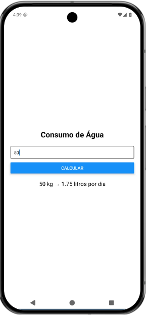

# Questão 01 – Hidratação Diária

Lista de Exercício 01 – React Native · Desenvolvimento para Dispositivos Móveis 

## Descrição
Calcula a estimativa diária de água (35 mL por kg) a partir do peso.

## Como usar
Digite o peso em kg e toque em **Calcular**. Valores vazios, negativos ou zero são recusados.

**Exemplo:** 70 kg → 2,45 litros por dia

## Tecnologias
React Native com Expo (componentes `View`, `Text`, `TextInput`, `StyleSheet` e o hook `useState`).

## Como executar
```bash
npm install
npx expo start
```
Escaneie o QR Code com o app **Expo Go** no celular (Android ou iOS).  
Também é possível colar o conteúdo de `App.js` em https://snack.expo.dev para testar no navegador.

## Capturas de tela

