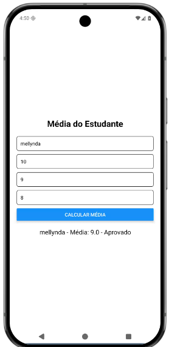

# Questão 02 – Média do Estudante

Lista de Exercício 01 – React Native · Desenvolvimento para Dispositivos Móveis (UFRA)

## Descrição
Recebe o nome e três notas, calcula a média aritmética e a situação (Aprovado com média ≥ 7,0).

## Como usar
Preencha o nome e as três notas (0 a 10) e toque em **Calcular média**.

**Exemplo:** Notas 8,0, 7,0 e 9,0 → média 8,0; Aprovado

## Tecnologias
React Native com Expo (componentes `View`, `Text`, `TextInput`, `StyleSheet` e o hook `useState`).

## Como executar
```bash
npm install
npx expo start
```
Escaneie o QR Code com o app **Expo Go** no celular (Android ou iOS).  
Também é possível colar o conteúdo de `App.js` em https://snack.expo.dev para testar no navegador.

## Capturas de tela

