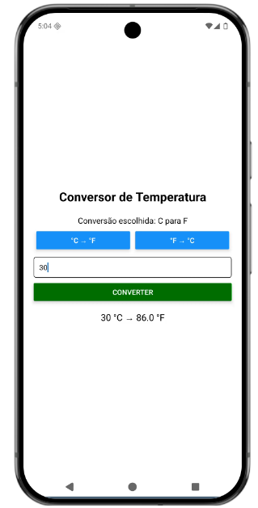

# Questão 04 – Conversor de Temperatura

Lista de Exercício 01 – React Native · Desenvolvimento para Dispositivos Móveis (UFRA)

## Descrição
Converte temperaturas entre Celsius e Fahrenheit.

## Como usar
Escolha o sentido (°C → °F ou °F → °C), digite a temperatura e toque em **Converter**. Fórmulas: F = (C × 9/5) + 32; C = (F − 32) × 5/9.

**Exemplo:** 30 °C → 86 °F

## Tecnologias
React Native com Expo (componentes `View`, `Text`, `TextInput`, `StyleSheet` e o hook `useState`).

## Como executar
```bash
npm install
npx expo start
```
Escaneie o QR Code com o app **Expo Go** no celular (Android ou iOS).  
Também é possível colar o conteúdo de `App.js` em https://snack.expo.dev para testar no navegador.

## Capturas de tela

