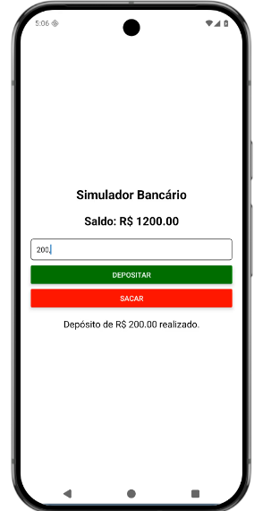

# Questão 05 – Simulador Bancário

Lista de Exercício 01 – React Native · Desenvolvimento para Dispositivos Móveis (UFRA)

## Descrição
Simula uma conta com saldo inicial de R$ 1.000,00 (não movimenta dinheiro real).

## Como usar
Digite um valor e toque em **Depositar** ou **Sacar**. Saques maiores que o saldo e valores não positivos são bloqueados.

**Exemplo:** Depósito R$ 200,00 e saque R$ 150,00 → saldo R$ 1.050,00

## Tecnologias
React Native com Expo (componentes `View`, `Text`, `TextInput`, `StyleSheet` e o hook `useState`).

## Como executar
```bash
npm install
npx expo start
```
Escaneie o QR Code com o app **Expo Go** no celular (Android ou iOS).  
Também é possível colar o conteúdo de `App.js` em https://snack.expo.dev para testar no navegador.

## Capturas de tela

